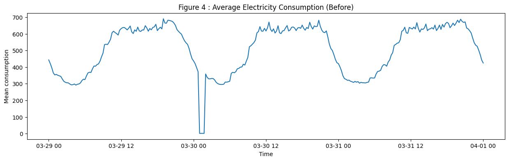
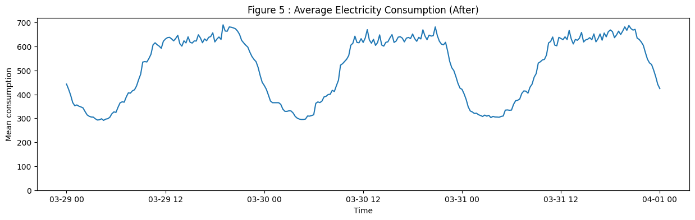
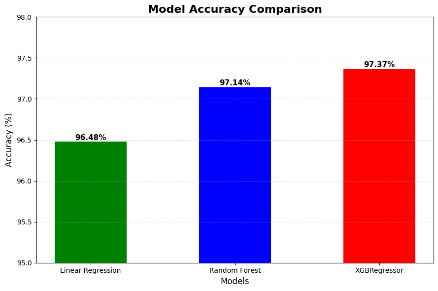
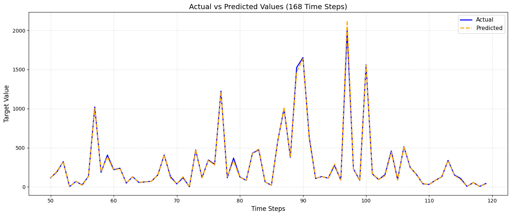

# Electricity-Consumption-Prediction
AI model that predict electricity consumption which helps electricity companies enough produce energy without wasting electricity

The Dataset used in this project is : electricityloaddiagrams20112014 
from : https://archive.ics.uci.edu/dataset/321/electricityloaddiagrams20112014

## Dateset description : 
    - 370 Time-series for 370 client
    - Each column represent one client
    - Record consuption in kW measured every 15 min.
    - Start at 1-1-2011 and End at 1-1-2015

## Preprocessing

* The issue with the time shift was resolved by calculating the average of the preceding and subsequent values ​​and using it to replace the corrupted data points.

#### Feature Engineering

* The features extracted from the DateTime is 
    - Month
    - Day of Week
    - Hour

* Furthermore, the previouse 168 hour consuption (Whole last week) as a context.

## Modeling

* Three models were being tested
    - Linear Regression
    - Random Forest
    - XGboosting

* The results were:

| **Model** | **Size on Disk** | **Training Time (Approximated)** |
|--|--|--|
|Linear Regression|4.8 KB|17 second|
|Random Forest|10 MB|5 minute|
|XGboosting|116.1 MB|10 minute|

---
## **Actual vs Predicted**

